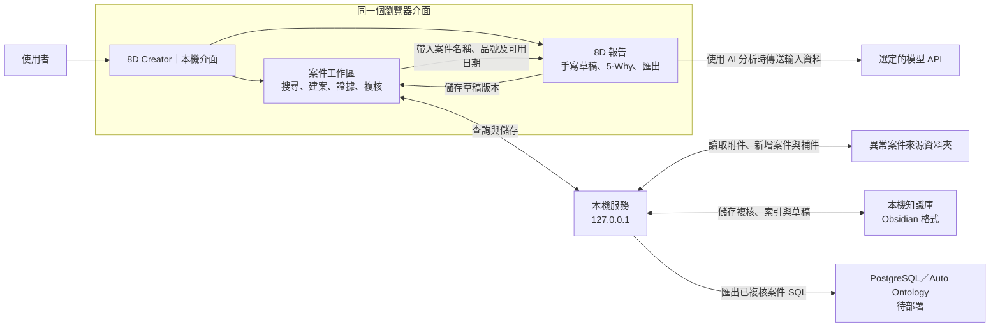

# 8D Creator 案件工作區

在同一個介面搜尋案件、查看附件、儲存複核和製作 8D 報告。現有 Obsidian 資料夾仍保存 Markdown 筆記及報告草稿。8D Creator 直接讀寫這些檔案。

## 啟動

1. 在專案根目錄的本機 `config.json` 設定 `qualityKb.source` 與 `qualityKb.vault`。分別填入來源資料夾與知識庫的絕對路徑。
2. 執行 `npm run build`。
3. 執行 `npm run local`。
4. 開啟 [案件工作區](http://127.0.0.1:3188/8D-Creator/)。

修改程式後，重新建置並重新啟動本機服務。可用 `npm run local -- --source <來源資料夾> --vault <儲存庫>` 測試另一份資料。

```json
{
  "qualityKb": {
    "source": "C:/Quality/Source",
    "vault": "C:/Quality/KnowledgeBase"
  }
}
```

使用完畢時，選取上方的「關閉伺服器」。本機服務會停止接受新請求，並等候正在執行的請求完成。

## 每日操作

開啟[專案地圖](http://127.0.0.1:3188/8D-Creator/#map)，依任務進入新增案件、搜尋、NCA 列管、8D 報告或經驗筆記。選擇 NCA 或從案件製作 8D 時，先搜尋案件。開啟案件後，系統會將焦點移到對應操作。

選取資料流程圖的節點，查看輸入、輸出與操作入口。若已知道要做的工作，可直接選取圖下方的快速入口。

GitHub Pages 與本機顯示同一張地圖。先啟動本機服務，再從遠端頁面選取案件入口。瀏覽器會開啟本機的對應操作。案件與 Obsidian 資料由本機服務處理。

進入功能後，頁面上方保留「目前路徑」和「下一步」。製作案件報告時，可選取「回原案件」。若先回地圖，再選取「繼續目前任務」，即可回到原畫面。

1. 在「案件工作區」搜尋品號、案件 ID、缺陷或同義詞。
2. 選取案件。查閱證據附件和同品號或同編號案件。
3. 在「複核」記錄缺陷、證據位置及判定。
4. 選取「儲存複核」。
5. 選取「製作 8D 報告」。
6. 選取「手寫 8D 草稿」，或使用 5-Why 分析。
7. 選取「儲存至案件」。回到案件即可開啟草稿版本。

使用 AI 前，可在報告頁選取「從案件加入參考附件」。在「經驗筆記與資料維護」可編輯經驗筆記、缺陷定義及同義詞。

用「新增案件」建立來源資料夾。用「匯入附件」加入檔案。系統保留同名的原始檔。若從其他管道補件，選取「同步案件」。Office 附件預覽顯示文字及前 100 列試算表資料。選取「匯出原始檔」可查看完整內容。

## 系統圖



## 專案地圖繪圖規範

間距使用 SVG 座標。縮放時，節點、連線和箭頭採同一比例。

| 項目 | 規範 |
| --- | --- |
| 節點 | 使用共用的 168 × 64 尺寸。矩形表示操作或資料。菱形表示判定。 |
| 連線 | 從圖塊邊緣中點出入。使用水平和垂直線段。轉彎前保留至少 20 單位的直線。 |
| 走線留白 | 連線中心與沿途其他圖塊的外框至少相距 20 單位。外側繞線須在畫布內保留至少 12 單位。 |
| 箭頭 | 使用共用尺寸。箭頭尖端與目標圖塊保留 2 單位。選取節點時，以色彩和線寬標示相關連線。 |
| 文字 | 將標籤放在連線旁的空白處。標籤字形與圖塊外框至少相距 8 單位。 |
| 字級與字重 | 分區標題用 14 / 500。節點標題用 15 / 500。節點說明和分支標籤用 12 / 400。菱形內的說明用 11 / 400。 |
| 分支標籤描邊 | 使用 2 單位的背景色描邊。 |

修改節點或路徑後，比對本機與 GitHub Pages 的地圖。確認預設與放大視圖都能辨識走線方向、分支標籤和箭頭。

## 資料範圍

- 本機服務只監聽 `127.0.0.1`。GitHub Pages 版提供獨立的 8D 報告介面。
- 新增案件與補件會寫入來源目錄。複核筆記與草稿會寫入本機儲存庫。
- 結案需填寫措施確效的附件、位置及結果。8D 草稿可保留多個版本。
- 歷史 CAPA 可在案件頁補件。系統將附件存入該案件的補件資料夾。
- 歷史 CAPA 的來源日期為發出日期。製作報告時，依證據填寫發生日期。
- 手寫草稿、查詢和複核可在本機完成。使用 AI 時，8D 流程會把輸入及選用的參考附件文字傳給目前的 AI 服務。

## AI 連線

- 從 Codex 啟動本機服務時，8D Creator 先偵測已登入的 Codex。偵測成功後，5-Why 與 8D 報告使用目前登入的 Codex 帳號，各次請求使用獨立工作階段。
- 在一般終端可設 `$env:EIGHTD_AGENT = 'codex'` 後執行 `npm run local`，明確使用已登入的 Codex。設成 `off` 可使用備援設定。
- 其他 Agent 可在啟動本機服務前設定 `EIGHTD_AGENT_URL` 為本機 HTTP 位址。服務需提供 `GET /status`，回傳 `{"available":true}`。用 `POST /generate` 接收 `{"prompt":"..."}` 並回傳 `{"text":"..."}`。
- 偵測不到可用 Agent 時，側邊欄顯示「AI 設定」。Agnes AI 的預設模型為 `agnes-3.0-flash`。Gemini 的預設模型為 `gemini-3.8-flash`，另可選 3.5 Flash-Lite 或 3.1 Flash-Lite。免費額度依專案而定。[Google AI Studio 定價](https://aistudio.google.com/docs/pricing#gemini-3.8-flash)
- Agent 離線後，檢查 AI 設定，再手動重試。每次請求只送到一個服務。
- 啟動本機工作區時，服務會查詢 Agnes AI 與 Google AI Studio 的公開定價，並核對內建文字模型。若官方另列免費模型或無法確認資格，工作區會顯示核對結果。每次成功結果快取六小時。模型選擇由使用者確認，核對過程只讀取公開資料。

## M13001 首版列管

1. 在原案件選擇 NCA 狀態。新增及歷史案件預設「待判定」。
2. 若僅供參考，選擇「僅供參考」並儲存。案件仍可搜尋、補件與製作 8D 報告。
3. 若已開立，登錄 NCA 單號、開立日期、證據附件和位置。可在清單依 NCA 狀態或單號查詢。
4. 登錄處置方式。全檢及重工以開立後一個月的同日暫算。遇到下月無同日或其他處置時，顯示「待確認」。可填人工確認期限。暫算日期須核對廠內日曆。
5. 填寫已確認的品號或製程、缺點代碼和等級。三個月回溯以目前 NCA 開立日期為基準，含起訖日。系統按品號與製程各自比對，只計入有證據的不同 NCA 單號。
6. 記錄隔離、追溯、覆驗、處置結果及既有會簽憑證。覆驗不合格時，在原案記錄「轉開新單」及新 NCA 單號。另在 CAPA 區記錄 CAPA 單號與確效結果。

首版依本機參考文件 M13001 Rev. L AI 修訂版提示處置及結案所需的證據。操作限制待真案試跑後確認。NCA 列管資料存於儲存庫的 `.quality-kb/control`，請隨儲存庫備份。
